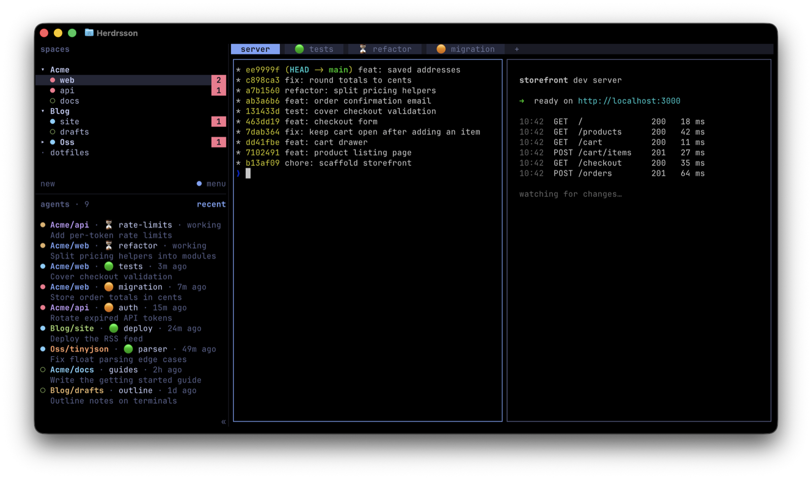

# Herdrsson

Herdrsson ("son of Herdr" in Icelandic) is a personal fork of
[herdrdev/herdr](https://github.com/herdrdev/herdr). It's unofficial: the Herdr project doesn't
make or endorse it. The `herdrsson` branch is Herdr's code with the changes below on top: usually
the latest Herdr release, currently 0.9.5. Everything else is stock Herdr; see the
[README](README.md) and [herdr.dev/docs](https://herdr.dev/docs/).

It installs and runs as `herdr`, with Herdr's config folder, plugins and agent integrations, so
the `herdr` commands and `~/.config/herdr/config.toml` below are right as written.

## why space groups

Herdr is meant to be run as one session, with a space for each piece of work. With several
projects that list gets long, and nothing shows which spaces belong together. Grouping spaces is
one of the most asked-for ideas upstream
([#1620](https://github.com/herdrdev/herdr/discussions/1620)), with nothing planned yet.

This fork groups spaces by name. A space named `Web/blog` shows as `blog` under a `Web`
header in the sidebar. Groups fold, have right-click menus, take spaces by "Move to group" or by
drag and drop, and keep the sidebar's order in step with Herdr's own. Navigation still goes
through every space, in the order the sidebar shows them.

Only the window knows about groups. The server, the API and the saved session keep the full name
and their own order, so nothing else changes: stock Herdr just shows `Web/blog` as the
space's name. If Herdr ever gets groups of its own, this fork will drop these and use them.



The groups `Acme` and `Blog` are open and `Oss` is folded, its header counting the agent waiting
in one of its spaces. Two separate Herdr plugins add the rest:
[Tab Status](https://github.com/bagonyi/herdr-tab-status) puts the 🟢 ⏳ 🟠 markers in front of
tab names, and [Agent Recency](https://github.com/bagonyi/herdr-agent-recency) lists the agents
panel by each agent's last activity, which this fork shows as `3m ago`.

## what's changed

### space groups

- A space you name `Group/name` is drawn under a ` ▾ Group` header, indented, showing just
  `name`. The group is the text before the first `/`, and the row shows the rest: `Web/app/x`
  shows `app/x` under `Web`. One level only. Case counts (`web` and `Web` are two groups), and
  a name with nothing on one side of the `/` (`Web/`, `/x`) isn't grouped. Only names you set
  count: a space shown by its folder name is never grouped.
- A group sits where its first space is in Herdr's space order, with its other spaces right
  after it, even when the order has them apart.
- Clicking a header folds the group to one row, which shows its spaces' most urgent status
  (blocked, then done, then working). A folded group still shows the space you're in and the one
  selected in Navigate mode. Each window remembers its folds, like its worktree folds.
- Right-clicking a header offers Collapse or Expand, and "Rename group...", which renames every
  space in it (`Web/x` becomes `Sites/x`). Renaming a group to another group's name merges the
  two.
- Right-clicking a space offers "Move to group": the other groups, "New group..." and, for a
  space in a group, "No group". Joining a group renames the space (a space without a name of its
  own takes its folder name, as `Web/<folder>`) and moves it after the group's last space. "No
  group" takes the group out of its name and puts it right after the group. Typing a group's
  name in the rename box does the same.
- Dragging a space onto a header adds it at the end of that group; between a group's spaces adds
  it there; between top-level rows takes it out of its group. Dragging a header moves the whole
  group. With one-line rows, a space from elsewhere can't be dropped straight into a group's
  first place, or between two folded groups; rename it or use "Move to group" instead.
- Whenever the window puts a space into a group or moves it, it moves it in Herdr's space order
  too, so that order matches the sidebar for the Goto picker, notifications and scripts. A rename
  from the CLI or API, or a new space created with a group in its name, isn't moved; the sidebar
  still draws it in its group.
- Previous and next space, the number keys and Navigate mode go through every space in the
  sidebar's order, folded groups included, and never stop on a header. The collapsed sidebar
  numbers spaces in the same order, so its numbers match the number keys.
- Herdr's worktree groups work inside a named group, indented 2 more columns, with their own
  fold.
- Everywhere outside the sidebar the full name shows: notifications, the window title, the Goto
  picker, the agents panel and the collapsed sidebar. With saved SSH machines, the sidebar lists
  machines instead and shows full names, in the grouped order, without headers.

### agents

- Each space shows a red count of agents waiting for you (finished and not yet looked at, or
  blocked with an open question), like an app badge. A folded group's header shows the total of
  its spaces, and a folded worktree parent counts its linked worktrees. In the collapsed sidebar
  a waiting space's number turns red. With SSH machines, a folded machine shows its total.
- A finished agent counts as looked at only once its pane has stayed on screen in the focused
  window for a second (the `seen_delay_ms` setting). Skipping past its tab on the way to another,
  or switching windows sooner, leaves it waiting for you: its red count, the tab bar's arrows and
  Tab Status's 🟢 stay. An agent's question keeps its red count the same way. Stock Herdr counts
  both as looked at the moment their tab shows. An agent that finishes while its pane is on
  screen in the focused window still counts as looked at straight away.
- A finished agent no one has looked at yet gets a green frame on its pane wherever the pane
  shows: for the second before it counts as looked at, or for as long as a window in the
  background shows it. The frame goes when the agent counts as looked at or starts working
  again; the red count, Tab Status's 🟢 and the API's `done` go with it. A pane's border turns
  green; a pane without a border (a lone pane, by default) gets the frame drawn over its
  outermost cells, so the program in it isn't resized.
- A pane hidden behind its tab's zoom, as in zen mode, isn't on screen: its finished agent waits
  until the pane shows. It gets no notification when it finishes there, as in stock Herdr, but
  its red count stays.
- A finished agent in a tab that comes on screen because the tab in front of it closed counts as
  looked at as if you had switched to it. Stock Herdr waits until you next type or switch
  windows.
- While no window is attached, and on a server no window has attached to yet, an agent that
  finishes in the tab last on screen counts as unseen until you look at it. Stock Herdr counts
  that tab as looked at. When a window comes back and its tab's agents count as looked at,
  plugins hear about it as they would on a tab switch, so Tab Status catches up.
- A window you open counts agents that finished while no window was looking, and any open
  questions, so closing and reopening it doesn't reset the counts.
- When the tab bar is too narrow for every tab, its < and > arrows show which way to look. An
  arrow takes the sidebar's colour for a finished agent while a tab hidden that way has one you
  haven't looked at, and the blocked colour (red) while one there is blocked, until you answer
  it. A tab cut short at the edge counts as hidden. Stock Herdr's arrows only show whether you
  can scroll.
- An idle agent counts as blocked through a fallback rule only once that reading has held for 5
  seconds. Herdr reads an agent's state from its screen. Most blocked readings come from rules
  that recognise a question or permission prompt by its controls; a few fallback rules (one each
  for Claude, Codex and Kimi) catch prompts those miss, and Claude's and Codex's match words like
  "would you like to" anywhere on the screen. An idle Claude's screen sometimes read blocked
  through its fallback rule for up to about 3 seconds, probably while Claude redrew it, and
  blocked then idle counts as finished: a tab untouched for days got a finished mark and a
  notification. A working agent's blocked readings still count at once, fallback or not (Claude
  asking to edit a file is one), as do prompts recognised by their controls. A prompt only a
  fallback rule catches that appears while the agent is idle shows 5 seconds late. Stock Herdr
  counts every reading straight away.
- The agents panel can be hidden, giving the spaces list the whole sidebar.
- The agents panel's title shows how many agents it lists, `agents · 24`, counting only those a
  plugin's agent view shows.
- A custom token in an agent or space row can show a Unix time in seconds as the time since
  then, counting up as you watch: `10s ago` (in steps of 10 seconds), `5m ago`, `3h ago`,
  `2d ago`. While an agent works, its row says `working` instead. Write it as
  `{ token = "$last_at", format = "ago" }`; its rules match that text. Stock Herdr shows the
  number.
- Notifications leave out the 🟢 ⏳ 🟠 marker that [Tab Status](https://github.com/bagonyi/herdr-tab-status)
  puts in front of a tab's name. The plugin changes it only after the notification is made, so a
  "finished" notification would still show ⏳.
- After a server restart, agents come back latest first: the Claude conversation with the newest
  message starts first, and agents without one follow in sidebar order. With
  `startup_per_agent_delay_ms` set to a few seconds, the agents you were using are back in
  moments while the rest trickle in. Stock Herdr starts them in sidebar order.

### mouse

- The tab, space row, group header or agent row under the mouse gets a lighter background. A
  sidebar row's sits halfway between the current row's colour and Navigate mode's cursor, so it
  reads as neither; in the `terminal` theme, which has no colours to mix, the row is underlined
  instead.
- The sidebar's dividing line lights up while the mouse is over it or dragging it.
- Ctrl+click works as a right-click on the sidebar, the tab bar and pane borders, as it does
  elsewhere on macOS. Terminals pass ctrl+click on to Herdr as a left click with Ctrl held, and
  stock Herdr treats it as a plain click there. On a pane's contents ctrl+click still opens
  links and reaches the program, and in an open menu or dialog it's a click.

### tabs

- Right-clicking a tab offers "Move to space": the other spaces, in sidebar order, by their full
  names. The tab moves to the end of the space you pick with its splits, zoom, name and running
  programs, and the window follows it there. Moving a space's last tab closes that space. Stock
  Herdr moves only single panes, and only with `herdr pane move`.
- The server does it as `tab.move_to_workspace` (`tab_id`, `workspace_id`, `focus`). As after
  `herdr pane move`, the tab's panes get IDs in their new space and the old IDs keep working. A
  server started before this version says it doesn't support the move yet; restart it.

### keys

- `last_tab` goes back to the tab you had open before this one in the same space, and
  `last_workspace` to the space you had open before this one (on any machine, with SSH
  machines). Press it again to come back. Each space remembers its own last tab; closed tabs and
  spaces, and machines that aren't online, are skipped. Both work in zen mode and are listed in
  the help overlay. Both are unset by default.
- `zen_mode` shows the focused pane alone, centred at `zen_width` columns (150 by default, at
  least 40, its frame and scrollbar included), with the sidebar, the tab bar and agent
  notifications hidden. Only the same key turns it off. It zooms each tab it shows, again after a
  split, a closed pane or a reconnect, but leaves a tab you zoom or unzoom yourself in zen mode as
  you set it. Leaving zen mode unzooms the tab on screen; any other tab it zoomed is unzoomed the
  next time a window shows it, including a window opened after the zen window closed. A plugin
  pane that takes the zoom, such as an overlay, keeps it, and zen mode undoes its own zoom once
  the plugin hands it back. In zen mode, `zen_narrower` and `zen_wider` make it 10 columns
  narrower or wider (outside zen mode those keys reach the pane as usual), and the window
  remembers the width; resize mode, the sidebar key and the space picker do nothing, as they
  would only change what zen mode hides. The screen holds while the pane comes back at its new
  size, so turning zen mode on or off or resizing it doesn't flash the sidebar. The prefix bar
  shows the zen mode key. All three keys are unset by default.

### plugin panes

- A pane a plugin opens as a split or a tab gets its real size straight away. Stock Herdr starts
  it at the size of the pane it splits, so a full-screen program in it could stay drawn at that
  size, cut off at the edge, until you clicked it.
- A plugin can open a split at a set size: `herdr plugin pane open --placement split` takes
  `--width 40%` for a split to the right or `--height 40%` for one below (`width` and `height` in
  `plugin.pane.open`), as a share of the pane being split, kept between 10% and 90%. It must be a
  percentage, given for the split's own direction. Stock Herdr takes them only for popups, so a
  split opens at half and visibly jumps when the plugin resizes it.

## settings

Eight settings are new; all go in `~/.config/herdr/config.toml`:

```toml
[ui]
# Milliseconds a pane must stay on screen before its finished agents count as looked at.
# 0 counts them at once, as stock Herdr does. Default: 1000.
seen_delay_ms = 1000
# Zen mode's width in columns, at least 40. Default: 150.
zen_width = 150

[ui.sidebar.agents]
# Hide the agents panel; the spaces list takes the whole sidebar. Default: false.
hidden = true

[keys]
# Back and forth between a space's two latest tabs, and between the two latest spaces.
last_tab = "alt+q"
last_workspace = "alt+w"
# The focused pane alone, centred, until pressed again.
zen_mode = "prefix+shift+z"
# Narrower and wider, only in zen mode; outside it these keys reach the pane.
zen_narrower = "ctrl+shift+h"
zen_wider = "ctrl+shift+l"
```

Herdr has no key for moving spaces up and down. Its socket API can (`workspace.move_block`), so
a `[[keys.command]]` with a small script can move the focused space within its group, or a whole
group, by keyboard.

## plugins

Three plugins that go well with this fork. All three work with stock Herdr too:

- [Tab Status](https://github.com/bagonyi/herdr-tab-status) puts 🟢 done, ⏳ working or 🟠 blocked
  in front of tab names.
- [Restore Commands](https://github.com/bagonyi/herdr-restore-commands) brings back commands such
  as `gh dash` and `lnav` in their panes when a session restarts.
- [Agent Recency](https://github.com/bagonyi/herdr-agent-recency) lists the agents panel by each
  agent's last activity, latest first, and shows when that was. On this fork the time can read
  `5m ago`.

## building

There are no prebuilt binaries; build it from source. You need
[rustup](https://rustup.rs) (it installs the Rust version in `rust-toolchain.toml`) and
[Zig](https://ziglang.org/download/) 0.16.0, either on `PATH` or named by the `ZIG` variable.

```bash
git clone -b herdrsson https://github.com/bagonyi/herdrsson
cd herdrsson
cargo build --release --locked
# then copy target/release/herdr somewhere on your PATH
```

Turn off Herdr's update check in `~/.config/herdr/config.toml`, and don't run `herdr update`:
both would replace Herdrsson with stock Herdr.

```toml
[update]
version_check = false
```

## versions

`herdr --version` shows two numbers: Herdrsson's own version, which is the date it was
released, and the Herdr release it's built on.

```
$ herdr --version
herdrsson 2026.10.28 (based on herdr 0.9.5)
```

A second release on the same day ends in `.2`. Moving onto a new Herdr release changes only the
Herdr number. Anything that compares versions, such as a plugin's `min_herdr_version`, still
uses the Herdr number.

- 2026.10.06 (on Herdr 0.9.3): the first release as Herdrsson.
- 2026.10.07 (on Herdr 0.9.3): the tab bar's < and > arrows show which way a waiting agent is; a
  plugin can open a split at a set size.
- 2026.10.08 (on Herdr 0.9.3): a finished agent counts as looked at only once its tab has stayed
  on screen for a second (`seen_delay_ms`).
- 2026.10.14 (on Herdr's code of 2026-10-08, after 0.9.3): rebuilt on Herdr's newest code. New:
  space groups by name, and zen mode. The green frame now shows while a finished agent waits,
  instead of for 2 seconds once it's looked at, and a pane hidden behind its tab's zoom no longer
  counts as looked at.
- 2026.10.25 (on Herdr 0.9.5): back on a Herdr release, with the fixes of Herdr 0.9.4 and 0.9.5.
  Nothing new of its own.
- 2026.10.28 (on Herdr 0.9.5): a tab's right-click menu moves it to another space, and ctrl+click
  opens the right-click menus. After a restart, agents come back latest conversation first. The
  agents panel shows how many agents it lists and highlights the row under the mouse, and a
  custom token can show a time as `5m ago`. An idle agent counts as blocked through a fallback
  rule only after 5 seconds, so idle Claude tabs no longer get stray finished marks.

## caveats

- Only built and tested on macOS on Apple silicon.
- The branch is rebased onto each new Herdr release and force-pushed, so `git pull` fails
  after an update. Use `git fetch` and `git reset --hard origin/herdrsson` instead; this throws
  away any changes of your own.
- With two windows on the one session, Herdr decides what's on screen from the tab of the window
  that acted last, not from the window you're looking at, so an agent you're watching in one window
  can still get its frame and a notification. One window at a time works as described above.
- Zen mode zooms a tab only once it shows, so with `seen_delay_ms = 0` a tab switch in zen mode
  briefly shows the tab's other panes, and their finished agents count as looked at. The default
  delay avoids this.
- `herdr agent focus` and `herdr pane focus`, as from a script, bring an agent on screen like a
  tab switch, so it counts as looked at only after the delay. Stock Herdr counts it at once.

## license

Herdr is licensed under the [Apache License 2.0](LICENSE). Herdr is the upstream project's name;
Herdrsson uses it only to say where it comes from. This fork changes files under `src/` and the
API schema generated from them (`docs/next/api/`), adds a note at the top of `README.md`, and adds
this file and `HERDRSSON_VERSION`. Each change is a separate commit on top of Herdr's code,
usually a release tag. This fork doesn't carry the tags, so fetch them from Herdr to list the
commits and every changed file:

```bash
git remote add upstream https://github.com/herdrdev/herdr
git fetch upstream --tags
base=$(git describe --tags --abbrev=0 --match 'v[0-9]*' herdrsson)
git log --oneline "$base"..herdrsson
git diff --stat "$base"..herdrsson
```
